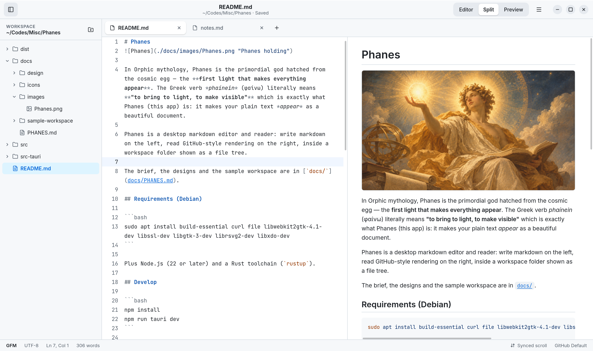
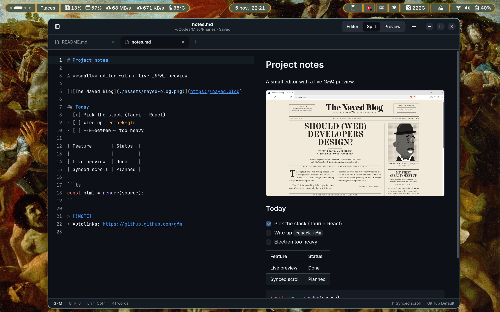

# Phanes


In Orphic mythology, **Phanes** is the primordial god hatched from the cosmic egg — the **first light that makes everything appear**. The Greek verb *phaínein* (φαίνω) literally means **"to bring to light, to make visible"**, which is exactly what **Phanes** (this app) is: it makes your plain text *appear* as a beautiful document.

---

**Phanes** is a desktop markdown editor and reader: write markdown on the left, read **GitHub Flavored Markdown** rendering on the right, inside a workspace folder shown as a file tree.



## Features

### Write and read side by side
- **Split view**: markdown on the left, rendered preview on the right, updated as you type.
- **Editor** and **Preview** modes for writing or reading full-width. Switch with the header buttons or `Ctrl+1` / `Ctrl+2` / `Ctrl+3`.
- **Synced scroll**: scrolling either pane keeps the other at the same place in the document. You can turn it on or off from the status bar at the bottom.

### GitHub Flavored Markdown
- Tables, task lists, strikethrough, autolinks and footnotes.
- **Code blocks highlighted with Shiki**, using GitHub's own light and dark themes.
- **Local images** with paths relative to the open file.
- **Links** open in your default browser. Links to other `.md` files open them in a new tab.
- **Safe by default**: the preview is sanitized, so no script in a document ever runs.
- **GitHub alerts**: blockquotes that start with `[!NOTE]`, `[!TIP]`, `[!IMPORTANT]`, `[!WARNING]` or `[!CAUTION]` become colored callouts with an icon. They look like this:

> [!NOTE]
> Phanes renders this as a blue callout with an info icon.

> [!TIP]
> Phanes renders this as a green callout with a lightbulb icon.

> [!IMPORTANT]
> Phanes renders this as a purple callout with a speech-bubble icon.

> [!WARNING]
> Phanes renders this as an orange callout with a warning triangle icon.

> [!CAUTION]
> Phanes renders this as a red callout with a stop sign icon.


### A real editor
- Built on **CodeMirror 6**, with markdown syntax highlighting, including highlighting inside fenced code blocks.
- Line numbers, current-line highlight, soft wrap, search (`Ctrl+F`), undo/redo and Tab to indent.
- Cursor position and word count in the status bar.
- Saving keeps the file's original line endings.
- **Relative line numbers**, as an option (main menu, or `:set rnu` in Vim mode).

### Vim mode
Optional: turn it on from the **Vim** toggle in the status bar or the main menu (**Vim Mode**). Specified in [`docs/VIM.md`](docs/VIM.md).
- Motions, operators, text objects, Visual modes, registers, macros, marks and `/` search, from [`@replit/codemirror-vim`](https://github.com/replit/codemirror-vim).
- A **mode pill** in the status bar (NORMAL, INSERT, VISUAL, V-LINE, V-BLOCK, REPLACE, COMMAND) in the colorscheme's own colors, with pending keys (`2d`), `recording @q` and the selection size.
- A block cursor, Visual selections tinted to match the pill, and a command line at the bottom of the editor with a match count for searches.
- Ex commands that act like the menus: `:w`, `:wa`, `:q`, `:wq`, `:x`, `:qa`, `:e path`, `:tabnew`, `:tabn` / `:tabp` (and `gt` / `gT`), `:Ex`, `:set wrap` / `rnu` / `nu` / `clipboard`, and `:theme name [light|dark]`.
- Yank and paste share the system clipboard (`clipboard=unnamedplus`, on by default).
- While the editor has focus, Vim gets its Ctrl keys (`Ctrl+W`, `Ctrl+O`, `Ctrl+N`…); `Ctrl+S`, `Ctrl+Tab` and the other app shortcuts keep working. The Keyboard Shortcuts dialog lists them.

### Workspace sidebar
- Opens a folder as a **file tree**, with markdown files and images, folders first. Hidden files, `.git` and `node_modules` are left out.
- Remembers which folders were expanded.
- **Right-click menu**:
  - New File and New Folder, with inline naming.
  - Rename (`F2`) and Duplicate.
  - Copy Path.
  - Open in Files.
  - **Move to Trash**. Files go to the system trash, so nothing is ever deleted permanently.
- The menus work from the keyboard too.

### Tabs
- One tab per file, with a dot marking unsaved changes.
- New untitled documents (`Ctrl+T` or the **+** button).
- Middle-click or `Ctrl+W` to close a tab, and `Ctrl+Tab` / `Ctrl+Shift+Tab` to cycle through them.
- If a tab has unsaved changes, Phanes asks before closing it or quitting: **Save, Discard or Cancel**.

### Picks up where you left off
- Reopens your last workspace and tabs on launch.
- Remembers your view mode, sidebar and color scheme.

### At home on GNOME
- A libadwaita-style header bar with rounded corners and the system shadow.
- Follows GNOME's **light/dark preference**, or you can force Light or Dark from the menu. The icon at the bottom right of the status bar cycles through Follow System, Light and Dark in one click.
- Four color schemes, each in light and dark: **GitHub Default**, **Gruvbox**, **Catppuccin** (Latte and Mocha) and **Everforest**. Click the color scheme's name in the status bar for a searchable list: the arrow keys preview each scheme live on the whole window, in your current light or dark mode, Enter applies it and Escape goes back.
- Opens and saves through **GNOME's own file chooser** (the desktop portal).
- Fast startup: the window shows up in about a second, already in the right colors.
- Installs a desktop entry, so Phanes appears in the app grid and Files can use it to open `.md` files.

### Command line
```bash
phanes                # reopen the last workspace and tabs
phanes notes.md       # open a file; its folder becomes the workspace
phanes ~/notes        # open a folder as the workspace
phanes .              # open the current directory
```
A path that doesn't exist opens as a new, unsaved file at that path.

### Keyboard first
Every action has a shortcut. Press `Ctrl+?` to see them all.

### Private
No accounts, no telemetry and no network access. The fonts (Inter and JetBrains Mono) ship with the app.

---
## Screenshots
#### Dark Theme


---
## Install

Download the package for your system from the [latest release](https://github.com/nayed/Phanes/releases/latest).

**Debian** (and Ubuntu): download `Phanes_*_amd64.deb`, then install it from the folder you downloaded it to:

```bash
sudo apt install ./Phanes_*_amd64.deb
```

**Fedora** (and openSUSE): download `Phanes-*.x86_64.rpm`, then install it from the folder you downloaded it to:

```bash
sudo dnf install ./Phanes-*.x86_64.rpm
```

On openSUSE, use `sudo zypper install ./Phanes-*.x86_64.rpm` instead.

**Arch** (and other distributions): download `Phanes_*_amd64.AppImage`, make it executable and run it:

```bash
chmod +x Phanes_*_amd64.AppImage
```

```bash
./Phanes_*_amd64.AppImage
```

The AppImage carries its own copy of WebKitGTK, which is why it's much larger than the `.deb` and `.rpm`. All three run on Debian 13, Ubuntu 24.04 and newer, current Fedora and openSUSE Tumbleweed. To build Phanes yourself instead, see [For developers](#for-developers).

### If something doesn't work

- **Open Folder or Save As does nothing, or opens a basic dialog:** Phanes asks your desktop for its file chooser through the desktop portal. GNOME has it built in; on other desktops (XFCE, for example), install `xdg-desktop-portal-gtk`. Without a portal, Phanes falls back to `zenity`, a simpler dialog.
- **To see what went wrong,** start Phanes from a terminal (`phanes`, or `./Phanes_*_amd64.AppImage`): problems are printed there. `RUST_LOG=debug phanes` prints more.

---
## For developers

### Tech stack

| Area | What |
| --- | --- |
| App shell | [Tauri 2](https://tauri.app), with the backend in Rust |
| Interface | [React 19](https://react.dev) + TypeScript, built with [Vite](https://vite.dev), state in [Zustand](https://zustand.docs.pmnd.rs) |
| Editor | [CodeMirror 6](https://codemirror.net) with its markdown language |
| Markdown | [unified](https://unifiedjs.com): `remark-parse` → `remark-gfm` → `remark-rehype` → `rehype-sanitize` → `rehype-stringify`, plus Phanes' own plugins for alerts, local images and source lines |
| Code highlighting | [Shiki](https://shiki.style), with each color scheme's own light and dark themes |
| Icons and fonts | [Lucide](https://lucide.dev), Inter and JetBrains Mono (bundled with Fontsource) |
| Rust side | `gtk` (the window's shadow and its light or dark variant), `trash` (Move to Trash), and Tauri's plugins for file dialogs (through GNOME's portal), opening links and the clipboard |

How it fits together on Linux: Tauri opens a **GTK 3** window holding a single **WebKitGTK** web view, and the whole interface is the React app drawn inside it. The frontend asks Rust for anything that touches the system (files, the light/dark preference, the window) through Tauri commands.

```
React app (HTML/CSS/TS)     src/
   drawn by WebKitGTK       libwebkit2gtk-4.1 (WebKit's API 4.1, for GTK 3)
   inside a GTK 3 window    libgtk-3
   managed by Tauri         src-tauri/
```


### Requirements
- [Node.js](https://nodejs.org) 22 or later, with npm
- A Rust toolchain, installed with [rustup](https://rustup.rs)
- The system libraries below

#### Debian
```bash
sudo apt install build-essential curl file libwebkit2gtk-4.1-dev libssl-dev libgtk-3-dev librsvg2-dev libxdo-dev
```
#### Arch Linux
```bash
sudo pacman -S --needed base-devel curl file openssl webkit2gtk-4.1 gtk3 librsvg xdotool
```

Arch also packages Node.js and rustup:

```bash
sudo pacman -S --needed nodejs npm rustup
```

```bash
rustup default stable
```

### Develop

```bash
npm install
npm run tauri dev
```

Arguments for the app go after a third `--` (the first is for npm, the second starts cargo's arguments, the third the app's). `tauri dev` runs the binary from `src-tauri/`, so relative paths start there:

```bash
npm run tauri dev -- -- -- ../docs/sample-workspace
```

`npm run dev` alone serves the UI in a plain browser at http://localhost:1420 with a fake backend (`src/dev/`) and the sample workspace mounted at `~/notes`, which is handy for UI work.

Checks:

```bash
npm run typecheck
cargo test --manifest-path src-tauri/Cargo.toml
```

### Build

```bash
npm run tauri build
```

This produces `src-tauri/target/release/bundle/deb/Phanes_*.deb`, `src-tauri/target/release/bundle/rpm/Phanes-*.rpm` and `src-tauri/target/release/bundle/appimage/Phanes_*.AppImage`. On Debian, install the `.deb`:

```bash
sudo apt install ./src-tauri/target/release/bundle/deb/Phanes_*.deb
```

On Fedora, install the `.rpm` (on openSUSE, with `zypper install` instead):

```bash
sudo dnf install ./src-tauri/target/release/bundle/rpm/Phanes-*.rpm
```

On Arch, or any other distribution, make the AppImage executable and run it:

```bash
chmod +x src-tauri/target/release/bundle/appimage/Phanes_*.AppImage
```

The AppImage is much larger (about 120 MB against 8 MB) because it bundles WebKitGTK and its libraries instead of using the system's.

Packages built on your machine only run on systems with the same C library (glibc) or newer. Published releases are built by GitHub instead, see below.

### Continuous integration and releases

Two GitHub Actions workflows live in `.github/workflows/`:

- **Check** runs on every push to `main` and every pull request: typecheck, frontend build and Rust tests.
- **Release** runs when a version tag is pushed. It builds the `.deb`, `.rpm` and AppImage on Ubuntu 24.04, so they work on Debian 13, Ubuntu 24.04 and newer (packages only run on systems with the build machine's glibc or newer), and attaches them to a **draft** release to review and publish by hand.

To release a new version, set it in `package.json`, `src-tauri/Cargo.toml` and `src-tauri/tauri.conf.json`, commit, then tag and push:

```bash
git tag -a v1.2.0 -m "Phanes 1.2.0" && git push origin main v1.2.0
```

The workflow refuses a tag that doesn't match the version in `package.json`. It can also be started by hand from the Actions tab to rebuild an existing tag; if that tag already has a release, the release is left unchanged and the packages are attached to the run instead.

### Layout

| Path | What |
| --- | --- |
| `src/app/` | App shell, startup, theme, synced scroll, quitting |
| `src/components/` | Header bar, sidebar and tree, tabs, status bar, menus, dialogs |
| `src/editor/` | CodeMirror setup (`extensions.ts`) and per-tab editor state |
| `src/markdown/` | The unified pipeline (`render.ts`), its plugins and the preview |
| `src/commands/` | The command registry and keyboard shortcuts |
| `src/lib/fs.ts` | The only module that talks to Rust about files |
| `src/state/` | Settings, workspace, tabs, file operations |
| `src/styles/` | `tokens.css` (colorschemes) and the rest of the CSS |
| `src-tauri/src/` | `fs.rs` (all file access), `cli.rs`, `window.rs`, `app_state.rs` |

---
## License

[MIT](./LICENSE) © 2026 Nayed Saïd Ali
