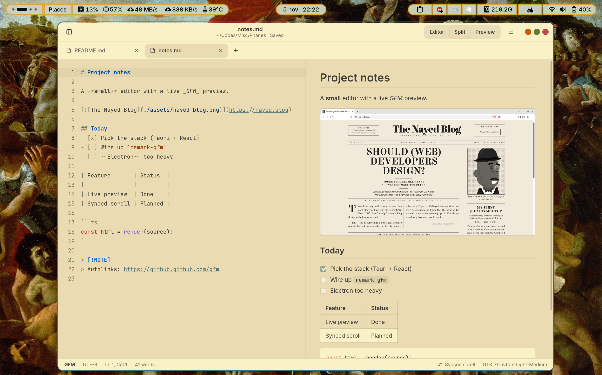

# Phanes


In Orphic mythology, **Phanes** is the primordial god hatched from the cosmic egg — the **first light that makes everything appear**. The Greek verb *phaínein* (φαίνω) literally means **"to bring to light, to make visible"** which is exactly what **Phanes** (this app) is: it makes your plain text *appear* as a beautiful document.

---

**Phanes** is a desktop markdown editor and reader: write markdown on the left, read **GitHub Flavored Markdown** rendering on the right, inside a workspace folder shown as a file tree.


## Features

### Write and read side by side
- **Split view**: markdown on the left, rendered preview on the right, updated as you type.
- **Editor** and **Preview** modes for writing or reading full-width. Switch with the header buttons or `Ctrl+1` / `Ctrl+2` / `Ctrl+3`.
- **Synced scroll**: scrolling either pane keeps the other at the same place in the document. You can turn it on or off from the status bar at the bottom.

### GitHub Flavored Markdown
- Tables, task lists, strikethrough, autolinks and footnotes.
- **Code blocks highlighted with Shiki**, using GitHub's own light and dark themes.
- **Local images** with paths relative to the open file.
- **Links** open in your default browser. Links to other `.md` files open them in a new tab.
- **Safe by default**: the preview is sanitized, so no script in a document ever runs.
- **GitHub alerts**: blockquotes that start with `[!NOTE]`, `[!TIP]`, `[!IMPORTANT]`, `[!WARNING]` or `[!CAUTION]` become colored callouts with an icon.

### Exemples
> [!NOTE]
> Phanes renders this as a blue callout with an info icon.

> [!TIP]
> Phanes renders this as a green callout with an lightbulb icon.

> [!IMPORTANT]
> Phanes renders this as a purple callout with a ! icon.

> [!WARNING]
> Phanes renders this as an orange with a warning triangle icon.

> [!CAUTION]
> Phanes renders this as a red callout with a stop signal icon.

### A real editor
- Built on **CodeMirror 6**, with markdown syntax highlighting, including highlighting inside fenced code blocks.
- Line numbers, current-line highlight, soft wrap, search (`Ctrl+F`), undo/redo and Tab to indent.
- Cursor position and word count in the status bar.
- Saving keeps the file's original line endings.

### Workspace sidebar
- Opens a folder as a **file tree**, with markdown files and images, folders first. Hidden files, `.git` and `node_modules` are left out.
- Remembers which folders were expanded.
- **Right-click menu**:
  - New File and New Folder, with inline naming.
  - Rename (`F2`) and Duplicate.
  - Copy Path.
  - Open in Files.
  - **Move to Trash**. Files go to the system trash, so nothing is ever deleted permanently.
- The menus work from the keyboard too.

### Tabs
- One tab per file, with a dot marking unsaved changes.
- New untitled documents (`Ctrl+T` or the **+** button).
- Middle-click or `Ctrl+W` to close a tab, and `Ctrl+Tab` / `Ctrl+Shift+Tab` to cycle through them.
- If a tab has unsaved changes, Phanes asks before closing it or quitting: **Save, Discard or Cancel**.

### Picks up where you left off
- Reopens your last workspace and tabs on launch.
- Remembers your view mode, sidebar and color scheme.

### At home on GNOME
- A libadwaita-style header bar with rounded corners and the system shadow.
- Follows GNOME's **light/dark preference**, or you can force Light or Dark from the menu.
- Two color schemes:
  - **GitHub Default** (light and dark).
  - **GTK Theme**, which takes its colors and window buttons from your current GTK theme (Gruvbox, Adwaita…).
- Opens and saves through **GNOME's own file chooser** (the desktop portal).
- Fast startup: the window shows up in about a second, already in the right colors.

### Command line
```bash
phanes                # reopen the last workspace and tabs
phanes notes.md       # open a file; its folder becomes the workspace
phanes ~/notes        # open a folder as the workspace
phanes .              # open the current directory
```
A path that doesn't exist opens as a new, unsaved file at that path.

### Keyboard first
Every action has a shortcut. Press `Ctrl+?` to see them all.

### Private
No accounts, no telemetry and no network access. The fonts (Inter and JetBrains Mono) ship with the app.


Phanes also installs a desktop entry, so it appears in the app grid and Files can use it to open `.md` files.

---
## Screenshots
#### Dark Theme

#### GTK Theme


---
## For developers

### Requirements
- Node.js
- Rust

#### Debian 
```bash
sudo apt install build-essential curl file libwebkit2gtk-4.1-dev libssl-dev libgtk-3-dev librsvg2-dev libxdo-dev
```
#### Arch linux 
```bash
sudo pacman -S --needed base-devel curl file openssl webkit2gtk-4.1 gtk3 librsvg xdotool
```

### Develop

```bash
npm install
npm run tauri dev
```

Arguments for the app go after a third `--` (the first is for npm, the second starts cargo's arguments, the third the app's). `tauri dev` runs the binary from `src-tauri/`, so relative paths start there:

```bash
npm run tauri dev -- -- -- ../docs/sample-workspace
```

`npm run dev` alone serves the UI in a plain browser at http://localhost:1420 with a fake backend (`src/dev/`) and the sample workspace mounted at `~/notes`, which is handy for UI work.

Checks:

```bash
npm run typecheck
cargo test --manifest-path src-tauri/Cargo.toml
```

### Build

```bash
npm run tauri build
```

This produces `src-tauri/target/release/bundle/deb/Phanes_*.deb` and `src-tauri/target/release/bundle/appimage/Phanes_*.AppImage`. Install the `.deb` with `sudo apt install ./Phanes_*.deb`.

### Layout

| Path | What |
| --- | --- |
| `src/app/` | App shell, startup, theme, synced scroll, quitting |
| `src/components/` | Header bar, sidebar and tree, tabs, status bar, menus, dialogs |
| `src/editor/` | CodeMirror setup (`extensions.ts`) and per-tab editor state |
| `src/markdown/` | The unified pipeline (`render.ts`), its plugins and the preview |
| `src/commands/` | The command registry and keyboard shortcuts |
| `src/lib/fs.ts` | The only module that talks to Rust about files |
| `src/state/` | Settings, workspace, tabs, file operations |
| `src/styles/` | `tokens.css` (colorschemes) and the rest of the CSS |
| `src-tauri/src/` | `fs.rs` (all file access), `cli.rs`, `window.rs`, `app_state.rs` |
