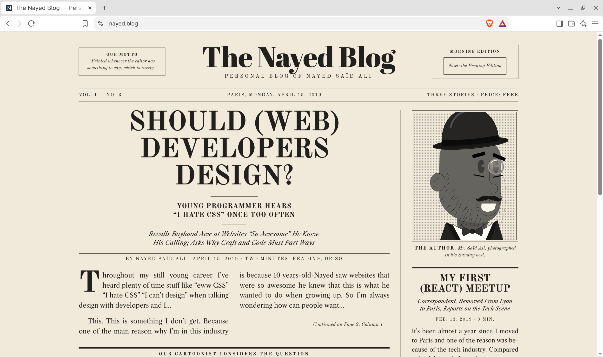

# Project notes

A **small** editor with a live _GFM_ preview.

[](https://nayed.blog)

## Today
- [x] Pick the stack (Tauri + React)
- [ ] Wire up `remark-gfm`
- [ ] ~~Electron~~ too heavy

| Feature       | Status  |
| ------------- | ------- |
| Live preview  | Done    |
| Synced scroll | Planned |

```ts
const html = render(source);
```

> [!NOTE]
> Autolinks: https://github.github.com/gfm
