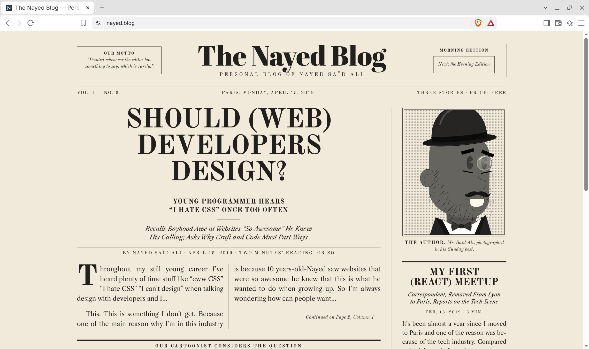

# Every GFM feature, for testing the preview

## Text

**Bold**, _italic_, ~~strikethrough~~, `inline code`, and an autolink: https://github.com

A footnote reference.[^1]

[^1]: And the footnote itself.

## Lists

1. Ordered
2. List
   - Nested bullet
   - [ ] Nested task

## Table with alignment

| Left | Centre | Right |
| :--- | :----: | ----: |
| a    |   b    |     c |

## Code

```rust
fn main() {
    println!("Hello from Phanes");
}
```

## Alerts

> [!TIP]
> Tips render green.

> [!WARNING]
> Warnings render amber.

> [!CAUTION]
> Cautions render red.

## Relative image



---

Raw HTML is sanitised: <script>alert("this must not run")</script>
